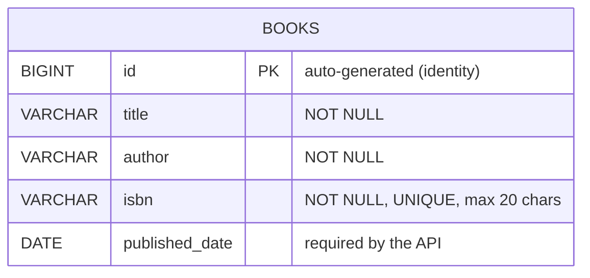

# ER Diagram

The service has a single table, `books`. 

## Column notes

| Column | Type | Constraints / behavior |
|---|---|---|
| id | BIGINT | Primary key, identity |
| title | VARCHAR(255) | NOT NULL |
| author | VARCHAR(255) | NOT NULL |
| isbn | VARCHAR(20) | NOT NULL, UNIQUE |
| published_date | DATE | Required by the API, validated as not in the future |
